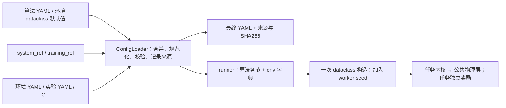

# 配置使用与扩展

> 后续物理与任务审查发现：参数到达Python消费者并不保证其影响电气状态或最终优化目标。
> 旧District的价格抵消、储能时钟与虚拟交换已在区域重建中替换，见[区域调度](district-physics.md)。
> DSR已重建为[有源静态恢复](dsr-physics.md)，定价任务已重建为[顺序响应](pricing-physics.md)。配置解析验收不能代替电气/交互验收。

公共多智能体入口、UI、环境配置类共用一条解析链。不引入 Hydra、插值语言或递归继承。
配置预览只需要 Python 3.10 和 PyYAML，不初始化 Torch、OpenDSS、Gradio 或环境。



## 从一个短实验开始

在当前 worktree 根目录执行：

```powershell
conda activate powerzoo-win
python scripts/train.py --config configs/experiments/vvc_13bus_smoke.yaml --print-config
python scripts/train.py --config configs/experiments/vvc_13bus_smoke.yaml --explain env.voltage_min
python scripts/train.py --config configs/experiments/vvc_13bus_smoke.yaml --validate-config
python scripts/train.py --config configs/experiments/vvc_13bus_smoke.yaml
```

CPU 是此示例的显式选择；CUDA 使用 `--set device.cuda=true`。请求 CUDA 而不可用时
训练会报错，不会静默转到 CPU。配置校验检查类型、字段和参数组合，**不等价于 DSS
求解成功、原始数据齐全或算法收敛**；安装与真实运行检查用 `scripts/check_runtime.py`。

启动前只检查或保存配置：

```powershell
python scripts/train.py --env vvc --algo happo --set seed.seed=0 --set env.voltage_min=0.94 --explain env.voltage_min
python scripts/train.py --config configs/experiments/vvc_13bus_smoke.yaml --save-config results/preview.yaml --validate-config
```

单独使用 `--save-config` 会保存后继续训练；配合 `--validate-config` / `--print-config` /
`--explain` 才会在解析后退出。所有数值、布尔、列表均用安全 YAML 解析，不执行 Python。
连续动作写 `.inf`；不再支持 `float('inf')` 这种 Python 表达式。

## 唯一配置形状与覆盖顺序

```yaml
run: {algo: happo, env: vvc, exp_name: voltage_trial}
system_ref: 13Bus
device: {cuda: false}
train: {episode_length: 120, n_rollout_threads: 2}
model: {data_chunk_length: 60}
env:
  max_episode_steps: 24
  voltage_min: 0.94
```

最终文档的顶层只有 `run`、算法默认文件声明的各节和 `env`。算法标准节为
`seed/device/train/eval/render/model/algo/logger`。环境字段表就是实际消费方的
dataclass，不再手工维护第二套类型 schema。`system_ref` / `training_ref` 只用于加载，
不作为运行期参数继续传递。

优先级从低到高：

1. 算法默认 YAML + 对应环境 dataclass 默认值。
2. 可选 `--algo-config` 算法覆盖文件。
3. **最终选定**的 `system_ref` 系统配置。
4. `configs/envs_cfgs/<环境或预设>.yaml`，可包含该环境推荐的训练参数。
5. 可选 `training_ref`，只接受实际算法参数节；用于显式选择共享训练设置。
6. 可选 `--env-config` 环境专用覆盖文件。
7. `--config` 实验文件；Python / UI 提供的同形状覆盖。
8. `--set 完整路径=值`。

引用先从上述文件中确定最终选择，再展开一次；不存在递归继承。
`--system` 显式选择系统引用，但环境/实验中明确写出的参数仍按上述优先级覆盖系统值。
因此跨系统实验应检查 `system_name/dss_folder/dss_file` 的最终组合。
`--algo/--env/--exp-name` 显式选择优先于实验文件的 `run`，不通过 `--set run.*` 改选择。
相对配置路径以项目根目录解析；相对输出路径以启动工作目录解析，推荐从 worktree 根目录启动。

映射逐键合并，列表和标量整体替换；`null` 是显式值，非 Optional 字段收到它会报错。
YAML 重复键、未知正式字段、缺失引用都报错，没有“警告后继续用默认值”的分支。
每次加载重新读文件；修改 YAML 后不需要清理单例缓存。

旧 JSON 的 `main_args/algo_args/env_args` 和旧 UI 包装格式在入口转换一次。
旧 `episode_length/num_steps` 环境键转换为 `max_episode_steps`，与正式键冲突时拒绝。
旧 Python `from_env_args()` 同样严格检查，只迁移已知旧名称；未知字段及非法 None 都会报错。
worker 只接收最终字段。新 Python 代码优先调用 `ConfigLoader.load()` 或 `build_dataclass()`。

旧 CLI `--name value` 仅在唯一匹配时兼容；例如 `--seed` 与 `--use_render` 有歧义会报错。
新实验统一使用 `--set seed.seed=42`、`--set render.use_render=false`。

## 最容易混淆的参数

| 参数 | 唯一职责 |
| --- | --- |
| `train.episode_length` | 每个训练环境每次采样的步数，允许跨越多个 episode |
| `env.max_episode_steps` | 单个 episode 的长度，独立于采样长度 |
| `model.data_chunk_length` | RNN 样本块长度；启用 recurrent 时必须整除采样长度 |
| `train.n_rollout_threads` | 训练环境数；不用另一个 `env.num_workers` |
| `eval.n_eval_rollout_threads` | 评估环境数 |
| `seed.seed` | 唯一全局基础种子，0 有效 |
| `env.seed` | 从基础种子派生的只读值，不应单独覆盖 |
| `render.use_render` | runner 进入渲染而非训练的模式选择 |
| `env.use_render` | 仅 VVC 保留的环境侧绘图；其他环境不开放无消费者的开关 |
| `env.dss_folder` | DSS 模型目录，可写绝对路径（例如临时模型副本） |
| `env.dss_file` | 该目录中的主 DSS 文件名 |

上表的采样长度独立性适用于同步MARL。`sequential_ppo`首版要求采样长度等于完整有限回合长度，
只支持单采样进程，并使用自己的精简算法字段表；不能把HAPPO的RNN/共享参数字段复制过去。

同步MARL路径对VVC、SmartGrid、District、DSR统一使用spawn，即使只有一个worker，也隔离训练/评估的DSS与随机状态。
定价通过同一入口分派到`sequential_ppo`，首版单采样进程、独立训练/验证context，禁止伪装同步worker。
worker seed 在构造环境之前设定；训练 `(seed + rank*1000) % 2**32`，评估
`(seed*50000 + rank*10000) % 2**32`，渲染 `(seed*60000) % 2**32`。
worker 不再先用 dataclass 的另一个默认种子创建环境。Python 在启动时已经确定哈希种子，
运行时设置 `PYTHONHASHSEED` 不会重置当前解释器的哈希；严格复现还需启动前设置它。

VVC/SmartGrid 的设备数量、容量来自 DSS，系统 YAML 不再提供可随意填写的计数或容量副本。
District 的拓扑、位置、容量用于建立运行对象，必须与 DSS 对应；数量由清单派生并核对。
更改实际拓扑需要同步更改 DSS。`configs/systems/_registry.yaml` 是界面选择器的说明元数据，
不会代替物理模型或覆盖训练参数。

## 环境侧生效边界

- **VVC**：`voltage_min/max` 进入电压奖励；动作离散数、连续电池、奖励系数进入
  `to_env_info()`；路径与关闭时清理都使用同一个配置。底层尚无有效 PV 控制实现，
  已移除无效的 PV 参数，正式入口拒绝这些字段；PV 实验请选 SmartGrid。
- **SmartGrid**：`reward_weights` 真正进入 CMDP 奖励。`power_loss/control/pv` 是主奖励
  三个系数；`capacitor/regulator/battery_soc/battery_discharge/pv_control` 是控制成本内部系数；
  `action_smoothing` 是平滑系数。过去这些 CRBP 权重被解析却未使用，接通后旧实验结果
  会改变，不能与旧日志当作相同实验比较。安全区间 `voltage_min/max` 用于越限报告和
  电压目标中心；CMDP 电压成本使用这个中心 ± `voltage_threshold`（默认 0.02），两者不同。
  `power_base`、Lagrange 更新参数及 `use_lagrangian_reward` 现在可以显式配置。
  设备动作直接使用 `reg_act_num/bat_act_num/pv_act_num/pv_control_enabled`，
  与 VVC 使用同样的动作数量词汇；电容器固定为二状态。旧 `regulator/battery/pv` 嵌套输入
  只在入口迁移一次。连续调压器、关闭 CRB 控制、非二值电容尚未实现，正式入口拒绝这些组合。
  配置、DataConfig、RewardWeights 都定义在 `envs/smartgrid/base_env/env_config.py`；
  数据读写与生成留在 dataset.py，配置预览不再导入 NumPy/Pandas/DSS。
- **DSR**：`data`指定故障JSON、split、SHA256与工程区间秒数；`control_groups`绑定真实
  Switch Line/Load，`priorities`按真实Load ID定义服务权重，额定值和相别只从DSS读取。
  电压/热约束、操作成本与非法动作成本均进入实际服务评价和奖励，实际交付电量与合格服务量分别报告。
  默认小网络和IEEE13派生算例已验收，旧8500预设已退役；详见[恢复任务说明](dsr-physics.md)。
  新算例使用独立`configs/envs_cfgs/dsr_<case>.yaml`，以`--env dsr_<case>`选择，避免覆盖现有算例
  时意外继承设备归属。映射逐键合并（空映射不会清除父值），列表整体替换。
- **Stackelberg**：消费者绑定真实Load清单，`load_fractions`与`retail_prices_yuan_per_kwh`直接定义实际离散动作。
  `wholesale_prices_yuan_per_kwh`按原生当前小时结算；不适参数、网络代理成本与电压约束实际进入逐主体元收益。
  不再接收ESS、消费者计数、异步噪声、伪Nash监测或旧分档价格配置。算法使用独立的精简
  `sequential_ppo.yaml`，只消费其声明的字段；见[阶段与账本说明](pricing-physics.md)。
- **District**：`regions`绑定真实母线和PV/Storage/SVG；容量、效率、SOC只从DSS读取。
  `market`与`costs`分别计算有单位的TOU金额和代理代价，固定尺度归一化，不抵消电价。
  `use_neighbor_obs`控制一跳邻区信息，不存在普通交流联络线P/Q动作。
  系统YAML只选模型和默认电压约束，不再投影另一套设备拓扑，详见[区域调度说明](district-physics.md)。

## 最终值、来源和重放

每次普通训练在结果目录保存：

- `config.resolved.yaml`：完整、类型已转换的参数，带 `config_kind: resolved`。
- `config.resolved.sources.yaml`：每个参数的覆盖历史和源配置文件 SHA256。
- `config.json`：保留旧格式读取兼容。

若 `seed_specify=false`，实际种子由公共 `prepare_run()` 在启动前生成一次；运行时快照记录实际种子并冻结
`seed_specify=true`，避免重放时再次抽签。启动前的预览仅表示请求值。

```powershell
python scripts/train.py --config <结果目录>/config.resolved.yaml --validate-config
python scripts/train.py --config <结果目录>/config.resolved.yaml --set train.num_env_steps=480
```

重放不会重新读系统和环境预设；算法默认文件仍用作字段/类型表。快照包含全部最终值。
仍需要同版本代码、DSS 模型和数据；YAML SHA256 不是整套数据或代码版本的冻结工具。
来源文件包含生成时的原文件摘要；重放时新的来源历史会以快照文件为起点。

## 快速增加实验或环境

同一环境换系统/奖励/训练组合：新增 `configs/experiments/<名称>.yaml`，只写差异。
同一环境维护常用预设：新增 `configs/envs_cfgs/<family>_<preset>.yaml`，使用
`--env-config` 选择；DSR / Stackelberg 已有直接选择的预设示例。
SmartGrid PV 方案使用 `--env smartgrid --env-config configs/envs_cfgs/smartgrid_pv_plans/smartgrid_aggressive.yaml`。
实际 PV 元件由 `node_systems/34Bus_PV/pv_plans/*.dss` 定义。

新增环境字段：在消费方 dataclass 声明类型和默认值，直接在消费方使用它，再在 YAML 写差异。
公共解析器和 UI 无需新增一套字段映射。legacy 核心若仍需要字典，仅在该环境的边界做一次命名适配；
SmartGrid正式奖励直接消费dataclass，District也不再往返转换字典。
新增环境家族：在 `utils/environment_registry.py` 的 `ENVIRONMENTS` 中登记配置类和包装器，
并注册对应 logger。包装器统一接收 `(config, rank=None)`。需要特殊系统投影时只修改 `_system_values()`，不要添加第二个加载器。

SmartGrid、DSR、District 的嵌套 dataclass 同样检查未知字段。Stackelberg 为兼容旧核心保留
少量字典子配置，但允许的实际键在 StackelbergConfig.validate() 限定；拼写错误也会报错。
聚合专属参数只在对应方法中使用，例如 `priority_weights` 用于 priority，
`spectral_clusters/consider_power_flow` 用于 graph，不能把条件分支的配置理解成所有模式都生效。
公共 CLI 可以替换完整列表，不支持 `list.0.field` 逐项索引；例如可直接覆盖
`--set env.market.base_price_yuan_kwh=0.7`。设备容量应修改DSS，不存在第二份district_devices容量表。

## 支持范围

本次统一的是五类电力环境的公共 MARL 入口。只有提供标准八节字典的算法默认文件才能
使用此入口；QMix、2TS、旧 DAN-HAPPO 和 SN-MAPPO 配置/runner 契约尚不一致，会明确拒绝。
SmartGrid 已提供共用内核的 SB3 PPO 入口 `examples/single_agent/scripts/train_smartgrid.py`；
旧研究脚本不再作为支持入口。数据配置、单位、动作及验证见 [SmartGrid 说明](smartgrid-data-runtime.md)。
完整代码定位、遗留路径和验证结果见 [参数流审计](configuration-audit.md)。

DSR 和 District 各自推荐的训练节与环境设置放在同一个环境文件，便于一起修改；
不再为了只引用一次而拆成 `configs/training/*_default.yaml`。通用短训练设置仍在
`configs/training/smoke.yaml`，五类实验通过 `training_ref: smoke` 共用；
只有真正重复使用的配置才抽取引用，不需要复制训练循环或整套默认参数。
详见[入口整理说明](training-entrypoints.md)。


## 配置精简历史（物理重建前的2026-10-28基线）

遵循三个判断：同一用途且只被引用一次的内容放在一起；不同物理问题保留各自配置；
只有存在实际读取并影响行为的参数才进入正式字段。单纯赋值、转发、日志描述不算控制能力。
不增加新的配置框架、通用 Env 基类、递归继承或多份字段注册表。

| 环境 | 精简前 → 后（顶层字段数） | 已移除的无效设置举例 |
| --- | --- | --- |
| VVC | 31 → 26 | `big2small/for_LLM/irrad_dss`、未实现的 PV 开关与动作数 |
| SmartGrid | 44 → 29 | 旧数据源别名、未消费的绘图/敏感度/噪声开关；四层设备对象改为四个动作字段 |
| DSR | 52 → 37 | `use_action_mask/use_dynamic_network/fault_scenarios`、未消费的过载/显示/负荷参数 |
| Stackelberg | 25 → 19 | 未实现的 TOU/阶梯价/N-1/奖励字典、空转的 circuit_adapter_config |
| District | 36 → 30 | `connection_mode/debug_mode/use_render` 与未消费的监控/日志开关 |

总计188 → 141个顶层字段；这是结构规模指标，不把计数减少本身作为正确性证据。
SmartGrid 不再需要按 worker 编号写模型文件，移除配置中的 worker_idx；进程编号保留在适配器。
DSR/District 无消费者的 scenario_name 删除，实验名称统一使用 run.exp_name。
嵌套项另删除了只存储不执行的异步延迟/动作持久化/预测、区域手写列表、碳监控等。
DSR 的 monitoring 仅保留真正调用监控器的 visualization/visualization_interval。
HAPPO 的 `sentivity_order` 没有读取者，已从算法默认值移除。

VVC 的旧 `_ENV_INFO/_SYS_INFO` 默认表已删除，字符串工厂也调用同一个 ConfigLoader；
保留旧名称和缩放的入口适配。34Bus 的系统引用原来指向不存在的 duty 文件，
现改为仓库实际存在的 ieee34Mod1_daily.dss。系统 YAML 删除假设备数量及未读字段，
未知系统键直接报错；123/8500 的标签显示配置也用实际消费者名 show_node_labels。

修改参数时用 `--explain` 检查最终来源；再以行为验证，例如测试电价翻倍、SOC 门限阻止控制、
邻居开关改变实际观测。不要只断言参数仍在字典里。行为测试见
`tests/test_configuration_effects.py`；真实运行检查仍使用 check_training/check_runtime/check_smartgrid。


早期 resolved 快照可能带有本次删除的字段，重放会明确报错。按上表删除无消费者项，
并把旧设备嵌套字段迁移为平铺动作字段；不要为了兼容快照重新开放无效选项。
字段属于特定功能时，只在该功能启用后生效，例如合成器参数不会控制 files 来源、
平滑权重不会控制关闭平滑的奖励。文件来源的非默认生成设置会被拒绝。


## VVC与SmartGrid共享物理入口

正式VVC不再构造to_env_info/to_sys_info视图，worker中的同一配置对象直接传给任务。
VVC、SmartGrid、District共享powergrid的DataConfig/ScenarioDataset、唯一运行场景换算及DSSSession，任务目标各自定义。
VVC的data.step_seconds默认3600，SmartGrid默认60；环境时长与算法采样长度仍分别设置。
旧VVC的scale/load_noise/显示/灵敏度标志已退役，使用实际data.load_scale/data.noise，详见[VVC记录](vvc-physics.md)。
系统文件只定义模型路径、动作分辨率、约束和基准权重；不再接受无消费者的display/source_bus设置。
<!-- LFC 补充 -->
- `lfc`：OHASAC 论文算例（OpenDSS+Simulink 联合仿真）；env 专用字段 f1~f7 奖励权重、system（13Bus/34Bus）、dss_file；MATLAB R2024a~R2025b 依赖边界与快速链路实验见 `configs/experiments/lfc_13bus_ohasac_quickstart.yaml` 与 docs/development.md 的 LFC 节。
