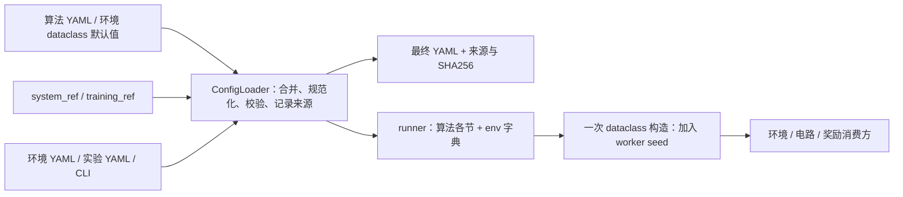

# 配置使用与扩展

公共多智能体入口、UI、环境配置类共用一条解析链。不引入 Hydra、插值语言或递归继承。
配置预览只需要 Python 3.10 和 PyYAML，不初始化 Torch、OpenDSS、Gradio 或环境。



## 从一个短实验开始

在当前 worktree 根目录执行：

```powershell
conda activate powerzoo-win
python examples/multi_agent/scripts/train.py --config configs/experiments/vvc_13bus_smoke.yaml --print-config
python examples/multi_agent/scripts/train.py --config configs/experiments/vvc_13bus_smoke.yaml --explain env.voltage_min
python examples/multi_agent/scripts/train.py --config configs/experiments/vvc_13bus_smoke.yaml --validate-config
python examples/multi_agent/scripts/train.py --config configs/experiments/vvc_13bus_smoke.yaml
```

CPU 是此示例的显式选择；CUDA 使用 `--set device.cuda=true`。请求 CUDA 而不可用时
训练会报错，不会静默转到 CPU。配置校验检查类型、字段和参数组合，**不等价于 DSS
求解成功、原始数据齐全或算法收敛**；安装与真实运行检查用 `scripts/check_runtime.py`。

启动前只检查或保存配置：

```powershell
python examples/multi_agent/scripts/train.py --env vvc --algo happo --set seed.seed=0 --set env.voltage_min=0.94 --explain env.voltage_min
python examples/multi_agent/scripts/train.py --config configs/experiments/vvc_13bus_smoke.yaml --save-config results/preview.yaml --validate-config
```

单独使用 `--save-config` 会保存后继续训练；配合 `--validate-config` / `--print-config` /
`--explain` 才会在解析后退出。所有数值、布尔、列表均用安全 YAML 解析，不执行 Python。
连续动作写 `.inf`；不再支持 `float('inf')` 这种 Python 表达式。

## 唯一配置形状与覆盖顺序

```yaml
run: {algo: happo, env: vvc, exp_name: voltage_trial}
system_ref: 13Bus
device: {cuda: false}
train: {episode_length: 120, n_rollout_threads: 2}
model: {data_chunk_length: 60}
env:
  max_episode_steps: 24
  voltage_min: 0.94
```

最终文档的顶层只有 `run`、算法默认文件声明的各节和 `env`。算法标准节为
`seed/device/train/eval/render/model/algo/logger`。环境字段表就是实际消费方的
dataclass，不再手工维护第二套类型 schema。`system_ref` / `training_ref` 只用于加载，
不作为运行期参数继续传递。

优先级从低到高：

1. 算法默认 YAML + 对应环境 dataclass 默认值。
2. 可选 `--algo-config` 算法覆盖文件。
3. **最终选定**的 `system_ref` 系统配置。
4. 可选 `training_ref`，只接受实际算法参数节。
5. `configs/envs_cfgs/<环境或预设>.yaml`。
6. 可选 `--env-config` 环境专用覆盖文件。
7. `--config` 实验文件；Python / UI 提供的同形状覆盖。
8. `--set 完整路径=值`。

引用先从上述文件中确定最终选择，再展开一次；不存在递归继承。
`--system` 显式选择系统引用，但环境/实验中明确写出的参数仍按上述优先级覆盖系统值。
因此跨系统实验应检查 `system_name/dss_folder/dss_file` 的最终组合。
`--algo/--env/--exp-name` 显式选择优先于实验文件的 `run`，不通过 `--set run.*` 改选择。
相对配置路径以项目根目录解析；相对输出路径以启动工作目录解析，推荐从 worktree 根目录启动。

映射逐键合并，列表和标量整体替换；`null` 是显式值，非 Optional 字段收到它会报错。
YAML 重复键、未知正式字段、缺失引用都报错，没有“警告后继续用默认值”的分支。
每次加载重新读文件；修改 YAML 后不需要清理单例缓存。

旧 JSON 的 `main_args/algo_args/env_args` 和旧 UI 包装格式在入口转换一次。
旧 `episode_length/num_steps` 环境键转换为 `max_episode_steps`，与正式键冲突时拒绝。
旧 Python `from_env_args()` 仍保留忽略额外键和 None 的兼容行为；正式训练通过严格解析器，
worker 只接收最终字段。建议新 Python 代码调用 `ConfigLoader.load()` 或 `build_dataclass()`。

旧 CLI `--name value` 仅在唯一匹配时兼容；例如 `--seed` 与 `--use_render` 有歧义会报错。
新实验统一使用 `--set seed.seed=42`、`--set render.use_render=false`。

## 最容易混淆的参数

| 参数 | 唯一职责 |
| --- | --- |
| `train.episode_length` | 每个训练环境每次采样的步数，允许跨越多个 episode |
| `env.max_episode_steps` | 单个 episode 的长度，独立于采样长度 |
| `model.data_chunk_length` | RNN 样本块长度；启用 recurrent 时必须整除采样长度 |
| `train.n_rollout_threads` | 训练环境数；不用另一个 `env.num_workers` |
| `eval.n_eval_rollout_threads` | 评估环境数 |
| `seed.seed` | 唯一全局基础种子，0 有效 |
| `env.seed` | 从基础种子派生的只读值，不应单独覆盖 |
| `render.use_render` | runner 进入渲染而非训练的模式选择 |
| `env.use_render` | 环境侧的渲染行为，不能用来替代 runner 模式选择 |
| `env.dss_folder` | DSS 模型目录，可写绝对路径（例如临时模型副本） |
| `env.dss_file` | 该目录中的主 DSS 文件名 |

worker seed 在构造环境之前设定；训练 `(seed + rank*1000) % 2**32`，评估
`(seed*50000 + rank*10000) % 2**32`，渲染 `(seed*60000) % 2**32`。
worker 不再先用 dataclass 的另一个默认种子创建环境。Python 在启动时已经确定哈希种子，
运行时设置 `PYTHONHASHSEED` 不会重置当前解释器的哈希；严格复现还需启动前设置它。

系统 YAML 的设备计数不是凭空创建设备的指令。VVC/SmartGrid 数量来自 DSS，
District 的拓扑、位置和数量必须与其配置匹配。更改实际拓扑需要同步更改 DSS。

## 环境侧生效边界

- **VVC**：`voltage_min/max` 进入电压奖励；动作离散数、连续电池、奖励系数进入
  `to_env_info()`；路径与关闭时清理都使用同一个配置。底层尚无有效 PV 控制实现，
  正式入口拒绝 `pv_control_enabled=true`，PV 实验请选 SmartGrid。
- **SmartGrid**：`reward_weights` 真正进入 CMDP 奖励。`power_loss/control/pv` 是主奖励
  三个系数；`capacitor/regulator/battery_soc/battery_discharge/pv_control` 是控制成本内部系数；
  `action_smoothing` 是平滑系数。过去这些 CRBP 权重被解析却未使用，接通后旧实验结果
  会改变，不能与旧日志当作相同实验比较。安全区间 `voltage_min/max` 用于越限报告和
  电压目标中心；CMDP 电压成本使用这个中心 ± `voltage_threshold`（默认 0.02），两者不同。
  `power_base`、Lagrange 更新参数及 `use_lagrangian_reward` 现在可以显式配置。
  连续调压器、关闭 CRB 控制、非二值电容尚未实现，正式入口拒绝这些组合。
- **DSR**：使用恢复环境自己的配置，训练参数已从旧平铺字段移到真实 `train/model/algo/eval`
  各节；13/8500 预设指定静态 DSS 主文件。恢复算法内部仍存在按系统名估算负荷和限制
  PV/开关数量的研究逻辑，见审计文档，不将其描述成动态拓扑自适应。
- **Stackelberg**：消费者数量、ESS、真实价格边界、历史长度等进入底层。
  ESS 的 `retention_factor` 是每步保留比例，旧 `self_discharge_rate: 0.001` 在入口转换为
  `retention_factor: 0.999`，避免把损失率误当作保留率；尚未实现的 ESS min_soc/max_soc 会拒绝。
  `tou_config/tier_config/reward_weights/n1_security` 原本未被底层消费，正式入口明确拒绝非空值。
  扩展这些能力应先实现消费逻辑，再开放配置；不从论文描述推定它们已经实现。
- **District**：市场价、SOC、效率、奖励、设备容量均到达消费方；拓扑在解析时展开，
  核心不再重新读取系统 YAML。当前同一台区的同类设备使用统一单机容量，异构容量在
  解析时拒绝；扩展时可以将设备配置改为逐设备 dataclass。

## 最终值、来源和重放

每次普通训练在结果目录保存：

- `config.resolved.yaml`：完整、类型已转换的参数，带 `config_kind: resolved`。
- `config.resolved.sources.yaml`：每个参数的覆盖历史和源配置文件 SHA256。
- `config.json`：保留旧格式读取兼容。

若 `seed_specify=false`，实际种子由运行器生成；运行时快照记录实际种子并冻结
`seed_specify=true`，避免重放时再次抽签。启动前的预览仅表示请求值。

```powershell
python examples/multi_agent/scripts/train.py --config <结果目录>/config.resolved.yaml --validate-config
python examples/multi_agent/scripts/train.py --config <结果目录>/config.resolved.yaml --set train.num_env_steps=480
```

重放不会重新读系统和环境预设；算法默认文件仍用作字段/类型表。快照包含全部最终值。
仍需要同版本代码、DSS 模型和数据；YAML SHA256 不是整套数据或代码版本的冻结工具。
来源文件包含生成时的原文件摘要；重放时新的来源历史会以快照文件为起点。

## 快速增加实验或环境

同一环境换系统/奖励/训练组合：新增 `configs/experiments/<名称>.yaml`，只写差异。
同一环境维护常用预设：新增 `configs/envs_cfgs/<family>_<preset>.yaml`，使用
`--env-config` 选择；DSR / Stackelberg 已有直接选择的预设示例。
SmartGrid PV 方案使用 `--env smartgrid --env-config configs/envs_cfgs/smartgrid_pv_plans/smartgrid_aggressive.yaml`。
实际 PV 元件由 `node_systems/34Bus_PV/pv_plans/*.dss` 定义。

新增环境字段：在消费方 dataclass 声明类型和默认值，直接在消费方使用它，再在 YAML 写差异。
公共解析器和 UI 无需新增一套字段映射。legacy 核心若仍需要字典，仅在该环境的
`to_env_info()/to_info_dict()` 边界做一次命名适配。
新增环境家族：在 `ENV_CONFIG_CLASSES` 注册配置类，在 `make_power_env()` 注册构造方式，
并注册对应 logger。需要特殊系统投影时只修改 `_system_values()`，不要添加第二个加载器。

SmartGrid 和 District 的嵌套 dataclass 同样检查未知字段。Stackelberg 部分子配置和监控配置
仍是明确的开放字典，由组件自行解释，不宣称其任意内部键都具有严格拼写校验。
公共 CLI 可以替换完整列表，不支持 `list.0.field` 逐项索引；整数键映射支持
`--set env.district_devices.2.storage_capacity_kwh=400`。

## 支持范围

本次统一的是五类电力环境的公共 MARL 入口。只有提供标准八节字典的算法默认文件才能
使用此入口；QMix、2TS、旧 DAN-HAPPO 和 SN-MAPPO 配置/runner 契约尚不一致，会明确拒绝。
SB3 单智能体训练仍是独立旧入口，其配置路径和底层 API 问题尚未完成迁移。
完整代码定位、遗留路径和验证结果见 [参数流审计](configuration-audit.md)。
