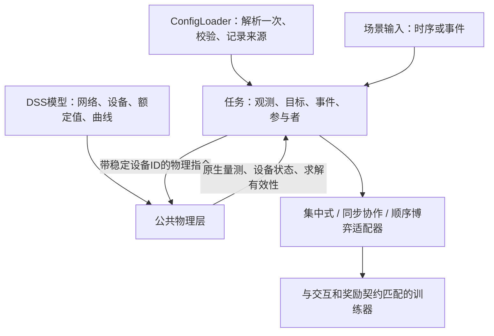

# 物理一致性重构与场景环境建设方案

研究日期：2026-10-28。代码基线：`c95b3949`，工作分支 `codex/config-simplicity`。
本文是待实施的设计，不表示公共物理层、新设备或新任务已经实现。
既有202项回归与五环境短训练验证的是现有配置、接口和运行链路，不是所有任务的电气正确性。

## 1. 建议与选择依据

建议以 SmartGrid 的原生 context 隔离、设备发现、原生读数、模型副本和已有验证作为起点，
抽出一套独立、较小的公共物理层。SmartGrid、VVC、区域调度、恢复、定价任务都是它的使用者。
不让其他任务继承 SmartGrid Env，也不把 SmartGrid 的全部假设复制到其他环境。

这是结合本项目现有资产和持续扩展目标的工程判断，尚不是几种架构通过实现对比后的实验结论。

| 方案 | 收益与代价 | 判断 |
| --- | --- | --- |
| 五环境直接继承 SmartGrid Env | 初期改动看似少，但同时继承固定设备循环、三类负荷、统一天气、全状态观测、CMDP奖励和回合语义 | 不采用 |
| 从 SmartGrid 提取公共物理机制，任务保持独立 | 复用已经运行和测试的部分，允许独立定义目标、事件、参与者及决策时序 | 推荐 |
| 所有物理能力完全重写 | 重复验证原生接口、Windows、context、单位和能量流程，收益有限 | 不作为首步 |
| 整体迁移到其他研究框架 | 会改动训练接口、模型和数据组织；当前尚未做迁移成本及Windows验证 | 参考其边界设计，暂不迁移 |

[PowerGym](https://proceedings.mlr.press/v168/fan22a.html)提供VVC任务与IEEE馈线基准；
[PowerGridworld](https://arxiv.org/abs/2111.05969)关注可组合的异构设备和多智能体环境。
它们支持“物理机制共享、任务单独定义”的研究方向，但不能代替本项目的原生设备验收。

## 2. 任务价值与代码复用应分别判断

| 当前环境 | 有价值的任务目标 | 当前实现判断 | 建议处置 | 优先级 |
| --- | --- | --- | --- | --- |
| SmartGrid | 高渗透率DER下的电压、无功、削减及储能协调 | 五类中物理链最完整；仍混合物理与任务，并有模型简化 | 保留，抽取公共物理能力，校准PV、Storage与SVG接口 | 第一批 |
| VVC | 机械调压、电容和储能协调，维护经典VVC基准及动作磨损成本 | 实际控制有基础，与SmartGrid有大量物理重复 | 保留任务、名称与可核对的基准；逐步退役独立旧物理核心 | 第一批 |
| District | 多区域DER协同、峰值管理、购电成本和局部信息协作 | 台区计量、能量时钟、奖励与交换模型有结构问题 | 保留目标和可核验DSS资产；重建调度核心与奖励，不继续叠补丁 | 第二批 |
| DSR | 故障后的带电恢复、开关序列、关键负荷供电 | 供电源、可恢复路径、PV映射和供电判定存在根本缺口 | 保留方向；从明确的恢复问题重新建设核心，审核后复用模型/包装器/可视化 | 第三批 |
| Stackelberg | 价格或激励对用户灵活性的影响、领导者与跟随者博弈 | 时序、物理映射、收益单位及训练目标不一致 | 重新定义任务并重建环境/采样契约；后置为独立研究任务 | 第四批 |

不因当前代码粗糙就取消任务，也不因目录、界面和日志很多就把核心视为已完成。
VVC与SmartGrid可共享物理层，但VVC的机械动作成本、旧基准和SmartGrid的DER安全目标仍可不同。

## 3. 实际代码及探针证据

### 3.1 SmartGrid：有复用价值，但不是通用父环境

- `envs/smartgrid/circuit_system/runtime.py`：独立 `DSS.NewContext()`、只改工作副本、原生设备发现、单位转换、求解失败抛错。
- `envs/smartgrid/base_env/runtime_env.py`：实际设置电容、变压器Tap、Storage和PVSystem；从端口读取功率；当前Python按实际功率推进SOC。
- 已有六类场景、context隔离、双spawn worker、单/多智能体物理一致性与真实短训练验证。
- 限制：DSS副本通过正则删除时序/控制语句，不能作为任意DSS脚本的通用解析器。
- 限制：固定三组负荷、同一区域PV共用天气；不适合直接作为所有新场景的数据规范。
- 限制：动作、观测、CMDP与物理状态写在同一个Env；设备类别和拼接顺序仍由多个固定循环定义。
- 限制：PV用修改Pmpp实现可用功率缩放，Q余量是保守估计；还需统一原生限额、优先级和夜间能力。

### 3.2 DSR：核心应重建

主要证据位于 `envs/dsr/core/dsr_core.py`：

- `_init_agents()`把前N个母线作为PV位置，没有绑定真实PV元件。
- `_execute_actions()`的PV动作仅更新Python `current_power`。本次调用真实方法并禁止任何circuit访问，动作仍成功把记录从0改为100kW，说明这条分支没有写入物理引擎。
- `_init_fault_management()`随机抽母线作为DG位置，没有在此创建对应的供电源及其容量模型。
- `_update_energized_buses()`以这些DG节点在仅含线路边的图中可达作为带电依据，没有纳入完整变压器支路及原生供电源语义。
- `_get_restored_load_ratio()`按负荷enabled状态和铭牌kW计恢复量，没有核对实际交付功率和供电电压。
- 故障资产不可用、开关断开与线路Enabled混用；同一动作编号指向过滤后的线路，需建立稳定映射。

因此，它不是补一条PV写入命令就能成为可信的黑启动或恢复环境。
实际主路径复用VVC的 `Circuits`；目录中另一个 `DSRCircuit` 不能被当作当前运行路径的实现证据。

### 3.3 District：物理量与目标函数同时需要重建

- `core/circuit_adapter.py::solve()`调用 `SolveNoControl()`，主step没有结束时间步；也没有手动积分Storage能量。
- 临时模型副本上的实际探针：连续3步输出约20kW，DSS时间仍为0秒，SOC仍为50%。
- `core/district.py::update_state()`按台区母线数比例分配全网负荷，不是实际台区计量。
- `core/power_exchange.py`与适配器使用虚拟Load/Generator对，不能把其结果直接解释成普通交流联络线潮流；相邻双方对同一交换键的指令还会顺序覆盖。
- 反向交换取无功绝对值，丢失无功方向；部分读数对P/Q取绝对值，丢失吸收/发出含义。
- 原生读取异常时存在返回1pu、0功率、50%SOC的兜底，会把不可用测量伪装成正常状态。

目标函数问题位于 `rewards/components.py`：

```text
economic_reward = -(net_purchase × price × dt) / (base_load × price × dt)
                = -net_purchase / base_load                 （正价格、正常分母分支）

carbon_reward = (PV × dt × carbon_intensity × carbon_price)
              / (PV_capacity × dt × carbon_intensity × carbon_price)
              = PV / PV_capacity                            （正常分母分支）
```

本次实际调用现有奖励方法，100kW负荷、20kW光伏：电价0.5和1.0时经济奖励均为-0.8；
碳价0.05和0.5时碳奖励均约0.2。参数进入了代码，但在目标中被抵消。
此前电价曲线和SOC门限的行为测试没有覆盖这些更深层问题。
这类归一化可用来定义相对净购电量或PV利用率指标；但若目标是价格驱动调度或碳经济价值，
它就移除了相应驱动。应明确采用实际成本目标，或更名指标并删除不起调节作用的价格项。

### 3.4 Stackelberg：任务语义与训练器需一起重建

- `stackelberg_vvc_env.py::_execute_stackelberg_step()`先执行领导者动作，再执行已随同传入的消费者动作。
  但runner之前一次性为所有智能体采样；本轮价格产生的中间观测没有用于重新采样跟随者动作。
- `stackelberg_game/circuit_adapter.py::apply_consumer_actions()`中的DER控制仍是占位分支，用户储能动作也没有完整物理执行链。
- `stackelberg_base_env.py`另维护ESS SOC，使用固定1小时步长；与原生储能状态之间缺少统一权威来源。
- 收益混用基准负荷、MW与按kWh标注的价格，部分收益缺少显式时间换算，另有固定吸收比例等未经设备测量确定的假设。
- `stackelberg_monitor.py`把领导者收益与平均消费者收益之差称为Nash gap。
  不同主体收益相等不是均衡条件；这只能作为收益差指标，不能证明不存在有利的单边偏离。

真正的价格/激励研究有价值。[Fochesato等的需求响应研究](https://arxiv.org/abs/2204.08730)
明确区分领导者决策、跟随者响应及双层问题，适合用作任务边界参考；不据此宣称本项目复现了其模型。

### 3.5 共同训练契约问题：EP只保存第一个奖励

`runners/on_policy_base_runner.py::insert()`在EP路径存入 `rewards[:, 0]`；
`on_policy_ha_runner.py::train()`把同一个EP优势交给各actor。
本次调用真实insert：输入两个智能体奖励 `[1, 9]`，critic实际保存 `[1]`。

这适用于已声明且实际一致的共享团队奖励，不能用于声称各台区分别优化局部收益，
更不能当作买卖双方都按自身收益进行策略优化的证据。
[HAPPO原论文](https://arxiv.org/abs/2109.11251)的顺序策略更新，也不等于市场领导者/跟随者的行动顺序。

## 4. 目标架构与最小公共接口



以下文件是拟议位置，不是现有API或新增可用配置：

```text
envs/powergrid/
    session.py     # context、编译、求解、时钟、生命周期
    devices.py     # 原生发现、按类别控制、能力约束与实际读数
    state.py       # 具名设备/端口/相节点的状态及有效性
    scenario.py    # 时序/事件推进的公共入口与单位/时间校验

envs/vvc/、smartgrid/、district_dispatch/、dsr/、stackelberg/
                   # 各自保留任务逻辑和训练接口适配
```

先用普通函数和少量dataclass实现。沿用现有 `EnvironmentSpec` 和 ConfigLoader，
不增加插件框架、递归配置继承或统一所有任务的大型Env父类。

物理会话的最小职责为 `reset / apply / solve / finish_interval / read_state / close`。
设备侧集中实现原生元件发现、指令转换与读数，任务不再直接到处写DSS命令。
新增特殊模型时只扩展相应设备处理，已发现的实际设备才能产生动作维度。

## 5. 参数、模型和数据分别由谁负责

| 内容 | 权威位置 | 禁止的重复来源 |
| --- | --- | --- |
| 接线、相别、kV/kVA/kW/kWh、曲线、设备原生能力 | DSS模型 | YAML再手写一份数量、容量和基准 |
| 可控设备选择、分区/主体归属、奖励与任务约束 | 对应任务配置 | 在工厂、核心、奖励中各自补默认值 |
| 负荷/天气/价格/EV事件/故障序列 | 有单位、时间和来源的数据文件 | 环境里另抽一套隐含时序或固定“论文值” |
| 求解过程与测量单位转换 | 公共物理层 | 每个任务重复转换W/kW、符号或电压基准 |
| 策略超参数与价值目标 | 训练配置与训练器 | 物理设备类决定训练算法 |

同一任务的相关设置可留在一个YAML的聚焦分节中，实验只写差异；真正重复使用的部分才抽出引用。
物理读数产生的设备清单是运行元数据，不是另一份需要手工维护的配置。
控制设备使用稳定的 `类别.名称` 标识；SVG语义需显式绑定，不能把所有Generator都猜成SVG。

继续使用公共数据准备入口，但按任务验证真实字段：
SmartGrid保留负荷/辐照/组件温度；District按需要增加价格及服务需求；DSR采用故障与操作事件。
不要求所有任务伪造三组负荷和天气，也不把尚无消费者的未来字段提前加入默认文件。

源模型应逐步整理为仅声明网络/设备/曲线的入口。仿真模式、时间和RL控制策略由公共运行时显式设置。
旧正则清理仅限已验收的旧模型兼容期；新增模型不依赖正则重写任意DSS程序。
批量建设设备若需要生成工具，应选择一个可编辑物理定义源，生成DSS后记录摘要，不能维护两套可编辑额定值。

## 6. 必须统一的物理执行规则

1. **区间与时钟明确。** 每个工程step对应一个有起止时间和dt的区间；规定输入采样/保持约定、量测有效时刻与下一动作可见信息。
   仿真时钟与数据轴一致。一次区间内的多次潮流迭代不等于多次时间推进。
2. **状态只更新一次。** 目标实现以原生Storage为能量权威，在成功的区间结束时调用一次原生时间步收尾；
   reset或无时间的观测求解不更新SOC。SmartGrid当前手工SOC路径先保留为对照，完成效率/空载损耗/限额一致性验证后切换，
   同一设备不能同时手动积分与原生积分。EV服务进度等非Storage任务状态仍由任务更新。
3. **控制职责明确。** RL直接控制的设备关闭对应自动控制或使用明确的外部调度方式。
   原生控制基线独立运行，允许更高层策略调节控制器设定，但不让两个执行者覆盖同一控制量。
4. **区分请求、执行和实际量测。** 保存归一化动作、换算后的请求、限幅后的指令、DSS实际P/Q及限制原因。
   奖励与计量采用实际量测；机械动作成本采用真实状态变化，不按重复请求重复收费。
5. **保留符号与相别。** 内部统一设备注入为正、主网进口为正；W/var只转换一次为kW/kvar。
   明确单相LN/LL和三相LL额定电压，按实际相节点读取，不能丢失Q方向或用绝对值替代流向。
6. **失败与停电分开。** 合法失电母线、无效测量、不可行控制、数值求解失败有不同标记。
   禁止用1pu/0功率/50%SOC伪装读取失败。求解失败不推进能量状态；数值错误应中止并记录，
   场景定义的任务失败可按其终止规则处罚，但不能拿未收敛量测计算正常经济收益。
7. **网络约束不等于设备限幅。** P/Q和SOC投影保证的是设备能力范围；电压/热限额惩罚不构成安全保证。
   网络可行性仍须求解和检查，必要的安全控制另行定义并记录干预。
8. **拓扑与策略空间可核对。** 动作顺序、设备归属、模型依赖文件及数据摘要进入运行记录。
   元件变化或顺序变化时拒绝无说明地重放旧策略。

所有原生属性访问先显式绑定目标元件、端口或变压器绕组，不依赖上一次调用遗留的ActiveElement。
未实现的设备能力应报错，例如不能把多级电容银行无说明地压成二状态。

[OpenDSS的Python控制说明](https://opendss.epri.com/PythontoOpenDSSInterface.html)
区分设备操作、控制器以及时间步收尾。实现时仍以本机固定版本的原生试验为验收依据，
不把文档中的旧COM示例当作安装COM的要求。

工程上优先每区间一次有效潮流；需要额外观测或控制迭代时可以多次无时间求解，
但只提交一次状态推进。先确定因果和时间语义，再做缓存、预分配和性能优化。

## 7. PV、SVG及后续设备怎么增加

### PV

保留原生铭牌Pmpp与kVA，明确动作究竟表示“可用功率削减比例”还是“相对铭牌上限”。
两者由一个设备适配器完成换算。读取原生温度/效率曲线、Q发出/吸收上限、优先级和夜间能力，
验证实际P/Q受容量、电流及工作状态约束。可用功率计算需与当前DSS曲线一致，不能再发明一套简化曲线。

隔离原生试验：Pmpp100kW、辐照倍率0.4、单位效率时输出40kW；
设置 `%Pmpp=50` 仍输出40kW，修改Pmpp到50才约为20kW。
这证实当前两个环境的动作含义不同；更换换算方法后应建立新基准，不能要求与旧错误语义的日志逐点相等。
[官方逆变器属性](https://opendss.epri.com/PVinverterproperties.html)明确 `%Pmpp` 为相对铭牌的有功上限。

### SVG

首版实现三相或明确单相的双向无功静态等效，使用具名原生注入元件，P近零或采用有依据的损耗模型。
验证吸收/发出Q的符号、额定能力及低电压电流边界。独立原生试验已验证Generator恒PQ等效的±30kvar响应，
但该试验不证明完整SVG模型已实现，也不意味着铭牌kVA会自动满足所有硬件电流约束。

[OpenDSS Generator模型](https://opendss.epri.com/Generator.html)提供恒PQ及限流PQ等选择。
先验证所选等效在研究电压区间的表现；暂不增加PLL、开关频率、滤波器等没有对应动态实现的参数。
PV逆变器夜间供无功与独立SVG是不同设备假设，分别声明和验证。

### 其他设备

继承同样的开发顺序：真实设备定义 → 能力范围 → 执行/量测 → 原生验证 → 任务动作。
例如EV服务期限、热舒适状态和SOP功率耦合需要各自状态方程，不能仅靠新增一个设备类型名称就宣布支持。

## 8. 各场景的具体建设范围

### 8.1 VVC / SmartGrid：先建立可信的运行控制基准

- VVC保留机械调压、电容切换与操作成本；SmartGrid保留DER协调和约束成本定义。
- 共享设备和潮流执行，奖励/观测/参与者划分仍在各任务中。
- 先验收小电路与13Bus，再验收34Bus、123Bus；8500节点在正确性和性能都达标后扩展。
- 旧模型的储能Generator表示需明确迁移到Storage；这类物理变更单独记录，不声称无损复现旧论文。
- 集中式和多智能体适配器在相同输入、相同物理动作下必须得到相同量测与状态转移。
- 全状态共享观测可作为协作基线；局部观测另行定义并检查实际可见信息，不能把共享全状态称为分布式部署。

### 8.2 District：重建为有网络约束的区域协同调度

首版边界：同一个真实交流网络内，各区域管理自己的PV、Storage、SVG；主网连接保留。
普通联络线功率由网络方程决定，actor通过设备控制影响潮流，不直接指定交流线路P/Q。

按元件实际连接和端口聚合台区负荷、DER、损耗与跨区支路功率，跨区变压器同样纳入。
首版采用可核算的全局团队目标，例如实际主网购售电成本、网损、削减和约束代价；
各区域诊断量仍分别记录，但不能把局部奖励塞给只训练团队价值的EP路径。
成本按实际kW×小时×电价计算，归一化使用固定参考尺度，不能用本轮电价把它消掉。
期末SOC或能量价值需明确，避免靠耗尽初始储能获得虚假优势。

已有EV元件如果只有功率倍率，应作为外生负荷；有到离站、需求电量和服务期限数据后，
再增加具有累计供能与缺供指标的EV调度子场景。
[CityLearn](https://www.citylearn.net/)可参考其服务需求与能量管理的任务组织，
但电网约束仍由本项目的OpenDSS求解，不假定采用CityLearn就自动拥有同样的网络物理。

SOP作为后续独立扩展：两端各有变流器能力，P满足含损耗的平衡，Q在两端独立受限。
它不能由当前“同P、同Q的虚拟传输”直接替代。
[SOP运行建模研究](https://ietresearch.onlinelibrary.wiley.com/doi/full/10.1049/tje2.70185)
给出了两端注入及容量/损耗耦合的参考。

### 8.3 DSR：先做有电源的静态恢复，再研究微网黑启动

第一版明确为“与有效上级电源相连的故障后供电恢复”。
先做有替代供电路径的手工小算例，再建立有明确物理开关、故障位置和可恢复上限的IEEE案例。
123Bus文件含Sw1–Sw8等开关表示，但含 `_OPEN` 母线的表达需规范解析；不能按名称就假定已存在可闭合的完整备用路径。

- 故障资产可用性、开关位置、负荷投入状态分开；故障未修复前动作不得使其恢复。
- 稳定设备ID绑定真实Open/Close或Enable/Disable语义，动作掩码来自真实状态。
- 可达图纳入线路和变压器；实际供电还需通过源、相别、容量、原生电压与交付功率检查。
- 奖励/指标关注优先级加权的实际供电量、未供电量和恢复时间，并计操作代价及网络约束。
- 失电节点不是“电压读取错误”，也不能当作已经恢复；初始无供电应产生真实的未供电成本。
- 单一调度智能体可作为最小基线，多区域开关/负荷代理在物理验证后接入。

恢复操作的持续时间在场景中明确，可先采用声明过的固定操作区间；
有可核验的时间定义后才报告kWh与恢复时间，否则先报告供电功率和操作步数。

第二版才增加孤岛和可形成电压参考的电源、燃料/储能与负荷恢复动态。
Grid-following PV不是默认黑启动电源；静态潮流可行也不证明频率、暂态或保护协调通过。
[PowerModelsONM](https://lanl-ansi.github.io/PowerModelsONM.jl/stable/)
及其[开关/负荷优化模型](https://lanl-ansi.github.io/PowerModelsONM.jl/stable/manual/mld_model.html)
可用作恢复约束与优化基线参考，初期不强制增加Julia或商业求解器依赖。

### 8.4 Stackelberg：单独建设顺序、非合作任务

该方向有价值，但优先级低于可信的物理运行和恢复任务。建设顺序如下：

1. 明确领导者、用户各自目标、价格与计量单位，以及可用灵活性；先用小型可穷举/可解析例子验证交易账本。
2. 领导者公布本轮价格或激励，跟随者获得这个新信息后再由各自策略采样。
3. 跟随者完成决策后执行同一套物理设备，求解一次工程区间并完成结算。
4. 各主体保留各自奖励、价值目标和轨迹；不能通过共享第一个奖励把竞争目标改成协作目标。
5. 以单边偏离的收益改进评估跟随者策略；领导者偏离评估需重新求跟随者响应，并说明均衡选择及近似范围。

决策阶段与工程时间是两个概念：价格广播或内部训练更新不应自行消耗一个物理dt。
第一版一个价格阶段加一个跟随者响应阶段对应一个工程区间，避免过早引入复杂谈判循环。

[PettingZoo AEC](https://pettingzoo.farama.org/api/aec/)
与[Parallel接口](https://pettingzoo.farama.org/api/parallel/)区分轮流与同步行动，可参考其交互契约。
本项目先用明确的阶段调度实现并测试，无需立即加入新框架依赖。

## 9. 算法接入与评价

| 任务交互 | 初始训练基线 | 必须满足的条件 |
| --- | --- | --- |
| 集中式运行/恢复 | PPO；小离散恢复可使用简单搜索/表格策略作对照 | 环境按完整物理状态转移，动作与观测空间明确 |
| 同步协作VVC/DER/区域调度 | 现有HAPPO；物理验证后接入MAPPO对照 | 明确共享团队奖励；EP路径要检查各智能体奖励一致 |
| 局部奖励的多主体协作或一般和博弈 | 单独审核/实现逐主体价值与轨迹 | 不能只切换EP/FP字符串就假定训练语义正确 |
| 领导者/跟随者定价 | 先固定规则或精确跟随者响应，再引入按阶段采样的独立策略学习 | 本轮信息因果、各自效用、双层响应及偏离评估全部验证 |

HAPPO和MAPPO之间的比较、异构动作支持、最优性或均衡性质，都是算法层单独验收事项。
其他已注册算法只有完成适配和真实训练后才进入支持矩阵。
新物理层并不要求替换现有训练器，但错误的任务/训练器组合必须提前拒绝。

环境评价先报告原始物理与经济量，再报告训练reward：
VVC电压越限与持续时间、损耗和动作次数；District实际成本/峰值/削减/期末SOC；
DSR实际供电与未供电能量/恢复操作；定价各主体效用、服务满足度及有定义的偏离收益。
规则基线、固定动作基线和可得的优化基线必须使用相同数据与物理约束。
测试集包括独立时序种子以及明确的负荷/PV/故障分布变化，不能只改策略随机种子。

## 10. 分阶段实施与退出条件

这里按可交付物和验收分阶段，不给尚无工作量证据的人日估算。

| 阶段 | 主要交付 | 通过条件 |
| --- | --- | --- |
| P0：固定问题与支持边界 | 将现有探针固化为有断言的回归；标记研究环境；增加EP共享奖励/交互契约检查 | PV空动作、SOC冻结、价格抵消、跟随者旧信息、收益丢失等均有可复现的失败证据；无静默错误组合 |
| P1：公共物理核心 | context/时钟/状态/设备基础；原生模型入口；PV/Storage/SVG基准；SmartGrid迁移 | 原生对照、守恒、能力边界、reset、双context/Windows spawn、无源文件修改全部通过 |
| P2：VVC与SmartGrid基准统一 | 两个任务共用物理层、保留明确的任务差异与旧配置迁移 | 相同物理指令结果一致；物理修正引起的旧新差异有说明；HAPPO与集中PPO短训练通过 |
| P3：区域协作调度 | 真实区域计量、Storage推进、实际经济目标、共享奖励基线 | 电价曲线改变会改变实际货币成本；充放电满足能量；团队收益不丢失；与规则/优化对照可核算 |
| P4：静态恢复重建 | 真实开关/源/故障绑定、实际供电判定、稳定动作及掩码 | 人工可解小例得到正确恢复上限与序列；无源不能恢复；永久故障不被重合；再接IEEE案例训练 |
| P5：定价博弈重建 | 阶段式采样、逐主体轨迹/价值、交易结算及响应基线 | 改本轮价格会进入本轮跟随者观测；主体奖励分别进buffer；小例偏离/响应结果与参考计算一致 |

各阶段独立提交；不在一次提交中同时更换奖励、动作语义、物理模型和学习算法。
保留旧版本以解释历史结果；新路径通过验收后才归档旧物理实现，不长期维护两套正式核心。

## 11. 具体验收清单

- 设备：每一种动作确实写入目标元件，并引起预期端口量或状态变化；不靠总reward非零作为证据。
- 电气：单/三相接线及电压基准、端口P/Q符号、全网有功平衡、变压器与线路电流/热限额。
- 储能：充/放电、效率、待机损耗、空满边界、dt变化、零时间重求解、reset；核对原生状态和独立能量账本。
- 时序：reset不消耗一步；区间推进一次；动作信息不得使用未声明的未来数据；量测、价格、天气和成本对应同一时间约定。
- 故障：合法失电与求解失败分开；未供电量不能由Enabled标志替代；有源/无源小例结果符合预期。
- 经济：固定动作下价格和碳价格的金额响应可核算，变价套利要考虑期末能量价值；归一化参考尺度不随本轮动作或价格抵消目标。
- 交互：行动者只有一个，或同轮同步，或明确阶段；各自奖励不能丢失，跟随者信息不能迟一轮。
- 运行：独立context、Windows单/多worker、固定输入确定性、模型只读、checkpoint对应动作清单及模型摘要。
- 训练：先满足上述物理断言，再进行CPU/CUDA短训练；更长训练和多数据种子评价单独报告，不以短训练宣称收敛。

原生/参考计算的容差按求解精度和重复试验确定，采用有单位的绝对误差与相对误差共同验收并固定在测试中。
不把尚未测定的阈值加入用户配置，也不以自动放宽阈值通过失败。

## 12. 持续增加新场景的实际流程

1. 用简短任务说明确定决策主体、观测、动作、物理时间、目标、失败与终止。
2. 选择已验收DSS网络和设备；若新增设备，先完成其原生测试。
3. 提供场景输入与单位、时间/事件校验；任务不另起配置加载器。
4. 实现任务特有的观测、目标和事件，并在现有EnvironmentSpec登记。
5. 按集中/同步/顺序交互选择适配器和合适的训练器，校验奖励契约。
6. 先验证可手算或可优化的小例及规则基线，再训练并保存输入、模型、动作清单和实际运行快照。

换馈线、负荷/PV水平、控制区域或奖励权重，优先作为现有任务的新算例/实验；
只有目标、状态转移或交互时序实质改变时才新增任务类。
频率控制、电磁暂态、机电动态和保护协调属于后续独立物理能力，不能通过本方案的静态潮流验收宣称支持。

## 13. 研究与探针记录

本轮新增探针没有修改训练或物理实现。生成结果位于本worktree的
`results/validation/physics_review/`（不提交Git）：

| 文件 | 内容 |
| --- | --- |
| `device_probes.json` | 同版本原生引擎的PV限幅语义与恒PQ SVG等效响应 |
| `storage_clock.json` | 独立Storage的SolveNoControl与FinishTimeStep时钟/SOC区别 |
| `district_clock.json` | 临时真实District模型连续放电但时间/SOC未推进 |
| `task_contract_probes.json` | 真实奖励方法的价格/碳价抵消、DSR真实PV动作方法不访问电路、EP真实insert丢弃后续主体奖励 |

方法调用探针证明对应代码路径的行为；小电路等效试验不能替代完整设备或全场景验收。
本轮未开展新的算法性能对比。既有HAPPO与SB3短训练结果仍按原验收范围解释。
