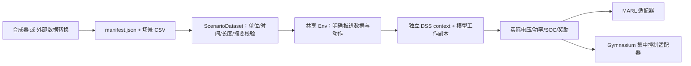

# SmartGrid 数据与运行设计

本内核首先在 `codex/smartgrid-data-runtime` 完成，从配置重构提交 `01926ba2` 创建。
后续入口整理继承于 `codex/training-entrypoints`，见[入口说明](training-entrypoints.md)。
当前整合后的 Windows 工作目录为 `D:\Exps\PowerZoo-worktrees\config-simplicity`。
正式基线为 IEEE34 + aggressive PV；验证结果说明运行与更新有效，不代表策略收敛。

## 从短训练开始

在本 worktree 根目录执行：

```powershell
conda activate powerzoo-win
python -m pip install --no-deps -e .
python scripts/train.py --config configs/experiments/smartgrid_synthetic_smoke.yaml
python scripts/check_smartgrid.py --train --require-cuda
```

第一条训练为 CPU HAPPO，19个智能体，240步/10次更新。去掉验收命令的
`--require-cuda` 可只运行 CPU；该命令还验证6类360步场景、双 spawn worker、
SB3 PPO 集中基线96步、CPU策略在 validation 上的12个回合，并检查本次保存的 MARL 模型参数均为有限值。
完整日志与 JSON 报告保留在 `results/validation/smartgrid/`。

## 一条数据链与一套仿真



`ConfigLoader` 负责参数解析；训练父进程先准备数据，缓存按生成参数摘要寻址，
用文件锁避免重复生成。worker只读取同一个不可变数据集。
直接构造 Env 时也经过同一准备函数，不存在另一套默认时序。
文件缺失、未知负荷映射、数据摘要错误、非法动作、求解不收敛直接抛错，
不返回零观测/零奖励，也不换月份、循环回填或回退常数数据。

## 单位与基准

| 输入/输出 | 约定 |
| --- | --- |
| 负荷时序 | 无量纲倍率，乘以 DSS 各 Load 的原始 `kW/kvar`，默认保持原始功率因数 |
| 辐照度 | 原生 `kW/m²`，直接赋给 PVSystem.Irradiance；外部 W/m² 必须先除1000 |
| 温度 | 光伏阵列/组件温度，摄氏度，直接赋给 PVSystem.temperature |
| PV 基准 | 原始 DSS `Pmpp`（kW）和 `kVA`；不采用配置中手写的设备数量/容量统计 |
| 储能基准 | 原生 Storage 的 `kWRated/kWhRated/%stored/%reserve/%EffCharge/%EffDischarge` |
| 电压 | DSS 自身电压基准下的 puVmagAngle 幅值，保留实际相导体 |
| 时间 | 秒；data.step_seconds 同时用于数据、DSS StepSize 和储能能量积分 |
| 功率读数 | CktElement.TotalPowers 已经是 kW/kvar，元件吸收为正；Circuit.Losses 是 W/var，转换一次 |
| 主网交换 | `total_power_kw/kvar = -Circuit.TotalPower`，注入配网为正；PV/Storage输出也以发电为正 |

负荷模型、线路、变压器额定参数仍由 DSS 定义。
PV温度/效率曲线从原 `pv_data.dss` 提取到 `pv_physics.dss`，由主模型引用，Python不再重新定义。
PV方案在DSS中绑定曲线；修改模型即可改变物理响应。原 `pv_systems_base.dss` 是符号链接，
现改为普通DSS Redirect文件，避免Windows将链接目标文本当作DSS命令。
原模型用两个0kW Generator 表示电池，却没有额定容量，无法推断能量基准；现改为
原生 Storage。新增的**基准假设**为每台100kW/200kWh、初始SOC50%、保留10%、
充放电效率95%、空载有功损耗0。这些值写在 DSS 中，修改模型即可改变基准，
不宣称它们是原论文参数或实测设备。其他 Generator 电池模型会明确报错，要求先补齐额定参数。

PV864 原来是三相设备接单相864.1，产生不供电的虚假相节点；三个 PV 方案已改成
单相变压器和单相PV，采用对应相电压。新内核不会过滤零电压来隐藏接线问题。
aggressive 模型实际为9个PV、总 Pmpp **1020kW**，6个单相调压器；以原生读数为准。

SmartGrid 的字段、数据和奖励类型集中在 `envs/smartgrid/base_env/env_config.py`。
动作直接配置 `reg_act_num/bat_act_num/pv_act_num/pv_control_enabled`，无需逐层设备包装。
数据读写和生成实现留在 dataset.py，纯配置预览不加载仿真依赖。

## 合成器的明确假设

每个数据集产生 train/validation/test 三个集合，各默认12个独立场景。
随机数由 `SeedSequence([data.seed, split_id, episode_id])` 生成，与策略/worker种子分离。
不同集合不共享文件或随机序列，但仍属于相同生成分布；泛化测试需另设负荷/PV倍率等分布。

- 三条分组负荷模板模拟住宅、商业、工业日变化，共同平滑扰动叠加组内扰动。
  默认通过负荷名称的稳定摘要分组，**这只是基准假设**；可用 `data.load_groups` 明确指定
  DSS负荷名到 residential/commercial/industrial 的映射。不同额定负荷始终保留自己的 DSS 基准。
- 辐照度采用白天正弦包络，加入晴天、持续阴天、连续云遮挡；同一区域PV共用天气，
  没有伪造互相独立的逐分钟天气。六类短场景为晴天、阴天、云遮挡、晚高峰、高PV低负荷、夜间。
- 温度采用日变化环境温度和 `T_target = T_ambient + 31.25 * G`，G单位kW/m²，
  再施加5分钟一阶热惯性。这相当于简化 NOCT=45°C 假设，没有风速模型，不能当作实测组件温度。
- 噪声使用AR(1)连续扰动，系数0.96、幅度由 `data.noise` 控制。
  生成器版本与全部生成参数写入清单；数据集逐文件SHA256固定，训练快照还固定清单SHA256。
- 默认360步×60秒对应6小时。超过6小时的窗口从0点开始，支持最多一整天；
  例如1440步×60秒用于昼夜储能调度。短训练24步只是链路检查。

辐照度、负荷倍率和温度均经过数值范围检查。读入后不再修改/缩放数据；
`load_scale/irradiance_scale/noise/seed/episodes_per_split` 仅用于合成来源。

## 显式生成与文件重放

```powershell
python scripts/generate_smartgrid_data.py --output results/datasets/smartgrid_day --steps 1440 --seed 0
python scripts/train.py --env smartgrid --set env.max_episode_steps=1440 --set env.data.source=files --set env.data.path=results/datasets/smartgrid_day/manifest.json
```

生成器拒绝覆盖非空输出目录。`source=files` 只读取指定清单，非默认的生成器参数会报错，避免误以为可再次缩放文件数据；
场景数量来自清单。适用于已生成数据或外部实测
数据的显式转换结果。仓库气象TXT的质量标志、列索引、环境/组件温度转换仍需专门审查，
此实现不会自动把它们变成“实测复现数据”。旧 month/irrad/temperature 加载器不再用于训练。

CSV固定列：

```csv
time_s,load_residential,load_commercial,load_industrial,irradiance,temperature
32400,0.6,0.8,0.7,0.75,45
32460,0.61,0.79,0.7,0.74,45.1
```

清单必须声明 `schema_version`、`units`（见dataset.py的UNITS）、`origin`、`episodes`。
每项场景声明 `id/split/scenario/file/sha256/steps/step_seconds`。时间轴必须连续，
行数恰好等于场景长度，无表头以外的日期列。实测数据需事先按同一时间窗对齐；
可用绝对秒时间轴，但不得让重叠实测窗口跨训练/测试集合。当前格式提供3组P/Q共同倍率；
逐设备独立曲线、独立Q曲线和逐站天气属于后续显式版本扩展，不能塞进未知列。

配置中的 data.path 相对仓库根目录；生成器 --output 相对当前工作目录。
评估 worker 固定读取 validation；最终测试通过单独 `data.split=test` 场景验收进行。
路径、清单摘要和数据生成来源都会进入训练配置记录；重放发现文件变化就报错。

## 动作、时间和奖励

- 每个电容器一个Discrete(2)，每个调压器一个Discrete(action_num)，按 DSS MinTap/MaxTap映射。
- 电池离散动作必须为奇数，中心是0功率，两端为额定充/放电；连续动作[-1,1]。
  先按额定功率、SOC、保留容量与效率限制动作，再以求解后的实际端口kW积分能量。
  snapshot求解不自动推进SOC，能量只由共享内核更新一次。
- 连续PV动作是 `[有功保留命令, 无功命令]`，两维范围[-1,1]。
  第一维映射为可用光能的0..100%保留比例；第二维映射为剩余kVA圆内的正负无功。
  无功范围按DSS原生温度曲线修正后的直流功率保守估计剩余容量，实际功率仍由DSS求解并受原生kVA限制。
  离散PV动作只控制有功保留比例，无功为0。
- HAPPO高斯动作执行前投影到设备空间；内核仍严格拒绝非法离散动作、NaN和维度错误。
- reset 在首条数据上做初始潮流，不推进储能；step t 使用第t条区间数据，在区间末求解并积分。
  观测包括设备状态、真实电压、天气、三组负荷倍率与回合进度；启用拉格朗日奖励时也包含λ。
- 数据定义完整的有限时域任务，场景结束是 `terminated=True, truncated=False`，
  不借助时间截断mask丢弃末步奖励。若未来添加外部训练时间限制，需另行处理terminal observation。
- 奖励主项为网损、控制成本、按DSS Pmpp归一化的实际PV发电。电压成本独立记录，
  默认公共配置启用 `use_lagrangian_reward`，使 HAPPO 实际收到电压惩罚。
  λ在回合末更新，普通reset保留，显式reset(seed=...)重置λ以便确定性复现。
  此实现是环境端的拉格朗日惩罚，不宣称是带安全保证的CMDP求解器。
- 奖励组件每步只计算一次，日志不会再次更新平滑历史。
  日志的 `pv_utilization` 兼容键现在明确表示实际kW/原始Pmpp，界面显示“PV出力/Pmpp”，
  它不是相对于当天天气可用功率的利用率。网损比例统一以实际总负荷有功为分母。

## 单智能体与多智能体

公共MARL接口为 `base_env.marl_adapter.VVCEnv`；集中控制接口为
`single_agent.adapter.SingleAgentVVCEnv`，两者都调用同一个runtime_env.Env。
MARL目前让各设备看到全状态，属于共享观测的协作基准，未宣称已实现局部观测分布式执行。

```powershell
python examples/single_agent/scripts/train_smartgrid.py --steps 240
```

集中控制默认使用Box动作，离散设备在适配器内等距量化；全离散环境也可直接使用MultiDiscrete，
不枚举所有设备动作组合。该PPO基线显式映射公共配置中的学习率、网络、gamma、GAE和采样长度，
其余SB3默认值保存在模型中；旁边保存环境YAML及实际SB3运行参数JSON。
旧 train_single.py/train_single_agent.py/enhanced_callback 及 SingleAgentTrainingConfig
不属于新支持入口，不继续维护其独立参数/回调逻辑，请迁移到上述脚本。

## 验收与限制

已验证数据确定性、三集合独立、六类场景、完整日时间轴、损坏数据拒绝、
原生PV有功削减与双向无功、负荷基准、有功平衡、储能能量、终止语义、同进程context隔离、
模型只读、单/多智能体物理结果一致、Windows双worker自动reset与实际短训练。
IEEE34的低电压场景会真实报告违规；不会通过过滤测点或伪造零成本让基准变好看。
短训练策略尚不能保证满足电压约束；其他电路和算法组合需逐项验收。
统计按实际环境回合步数求平均，与训练器采样长度分开；可视化JSON转换NumPy标量，
验证集指标写入同一TensorBoard事件文件，避免Windows重复指标目录超长导致评估中断。

2026-10-28 本机验收（Python3.10.22、NumPy1.26.4、Torch2.6.0+cu124、RTX3080）：

| 检查 | 实测结果 |
| --- | --- |
| 相关pytest | 202 passed，0 skipped（配置精简后的整组相关回归） |
| 通用Windows运行检查 | `POWERZOO_RUNTIME_OK`，两套原生DSS接口、VVC单/双worker、CPU/CUDA更新通过 |
| SmartGrid原生场景 | 六类各360步均收敛，实际设备数2电容/6调压器/2储能/9PV |
| SmartGrid spawn | 2 workers ×26步，跨24步回合自动reset，观测形状[2,19,153] |
| HAPPO CPU | 240步、10次更新；独立validation数据共12个评估回合 |
| HAPPO CUDA | 240步、10次更新 |
| SB3 PPO | 96步、4次更新，保存模型及实际参数JSON |
| 保存模型 | 本次88个MARL模型文件中的张量全部为有限值 |
| 安装及语法 | `pip check`、相关Python编译和`git diff --check`通过 |

测试命令：

```powershell
python -m pytest tests/test_smartgrid_dataset_runtime.py tests/test_configuration_contract.py tests/test_windows_runtime.py tests/test_unified_config.py tests/test_config_pipeline.py tests/envs/smartgrid/test_env_config.py -o addopts='' -q
```

完整报告：`results/validation/smartgrid/report.json`；训练日志为同目录下
`happo_cpu.log/happo_cuda.log/sb3.log`，权重位于 `runs/` 和 `sb3_ppo.zip`。
这些生成结果不提交Git，验收脚本可重建。
六类360步验收使用保持初始档位/零储能功率/PV全出力的固定控制；夜间末步最低电压约0.849pu，
属于真实低电压工况。短训练证明优化和保存链路可用，不代表策略已收敛或电压约束已满足。

原生单位依据：[OpenDSS PV运行条件](https://opendss.epri.com/Operatingconditionsproperties.html)。
组件温度与环境温度的区别参见 [Sandia PV温度说明](https://pvpmc.sandia.gov/modeling-guide/2-dc-module-iv/module-temperature/)。
