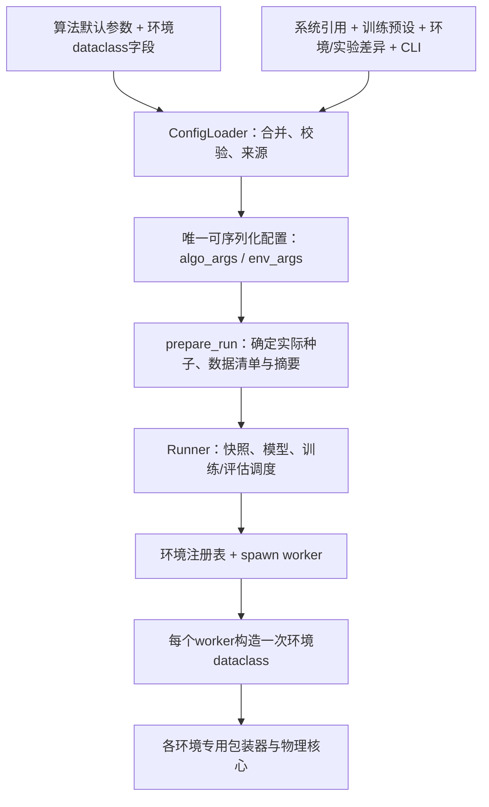

# 训练入口与参数流整理

本次从 `3f47f9f4` 建立 `codex/training-entrypoints`，工作目录为
`D:\Exps\PowerZoo-worktrees\training-entrypoints`。不修改主工作区，不合并或推送。

## 当前结构

五类电力环境共用 `scripts/train.py`，实际实现只有 `utils/train_cli.py` 一份。
`examples/multi_agent/scripts/train.py` 保留为兼容路径，也调用同一函数。
SmartGrid集中控制PPO使用SB3后端，共用配置解析、启动准备和仿真；不混用MARL训练循环。



配置职责：

| 位置 | 唯一职责 |
| --- | --- |
| `configs/algos_cfgs/` | 算法默认值及其字段/类型依据 |
| `configs/systems/` | 系统路径、设备说明、拓扑及系统级配置 |
| `configs/envs_cfgs/` | 环境参数与 `system_ref/training_ref` 选择 |
| `configs/training/` | 可复用训练参数；环境常规预设与通用smoke预设 |
| `configs/experiments/` | 某次实验的选择与差异 |
| 环境dataclass | 该环境允许的字段、类型及约束 |
| DSS模型 | 实际电气设备、额定值、接线与原生物理参数 |

原DSR三个预设和District文件中混在环境参数旁的算法节，已移到对应的
`configs/training/*_default.yaml`，原默认值保持不变。五个smoke实验均通过
`training_ref: smoke` 共用一份CPU HAPPO训练设置，不再复制网络、采样和优化器参数。
这是一层明确引用，没有递归继承、插值或新的配置框架。

## 删除了哪些冗余流转

| 原路径/做法 | 当前处理 |
| --- | --- |
| SmartGrid父进程为准备数据重复构造完整SmartGridConfig | 共享prepare_run只读取已校验的data子配置 |
| MARL与SB3分别绑定数据路径/摘要和来源 | 共用prepare_run，同一清单绑定与幂等来源记录 |
| 随机种子到Runner时才再次选择 | 入口选择一次并冻结，数据种子独立，实际值进入来源记录 |
| District：字典→dataclass→asdict→再规范化和构造dataclass | 工厂直接把typed对象交给包装器和核心 |
| SmartGrid：dataclass→大份旧info字典→奖励旧别名映射 | 正式奖励直接读取SmartGridConfig |
| 环境配置类清单与工厂if/elif各维护一份环境列表 | 一个EnvironmentSpec注册表同时声明配置类、包装器和进程策略 |
| VVC复制公共log_train/log_env实现 | 删除重复实现，继承公共日志行为 |
| 单指标add_scalars反复生成目录，Windows评估阶段路径超长 | 公共ScalarWriter把标签写入同一个事件文件，同时保留summary.json |
| 并行返回格式错误后构造全零数据继续训练 | 报错停止；检查智能体数量和数值有限性 |

保留两种必要边界，不为了减少行数强行合并：

1. 最终字典负责进程传输、快照和来源；worker内的dataclass负责消费方类型契约。
   解析时和worker构造时的校验作用不同，不再缓存一个可能与字典不同步的第二份配置对象。
2. VVC和Stackelberg的旧物理核心仍需要明确的字典视图。其环境边界保留一次适配，
   不让核心重新读取YAML。后续可以迁移核心，但本次不把不同物理问题强塞进一个通用Env基类。

## 五类环境的统一与差异

公共注册表为 `utils/environment_registry.py`，包装器统一接收 `(config, rank=None)`。
公共MARL契约仍是reset返回3项、step返回6项，以及每智能体空间、seed、close。
物理语义、动作、观测和奖励保留在各环境中。

| 家族 | 专用配置 | 包装器后的消费方式 |
| --- | --- | --- |
| VVC | VVCConfig | typed配置→旧核心一次info适配 |
| SmartGrid | SmartGridConfig / DataConfig | typed配置→共享内核、数据入口、奖励；DSS只读工作副本 |
| DSR | DSRConfig | typed配置→恢复核心；故障、负荷聚合为专用配置 |
| Stackelberg | StackelbergConfig | typed配置→旧博弈核心一次字典适配 |
| District | DistrictDispatchConfig及设备/拓扑dataclass | typed配置直接交给核心，不再往返解析 |

五类公共MARL环境统一使用spawn，包括单worker。多个旧核心使用进程级DSS引擎，
训练和评估环境不能放在同进程互相覆盖；这也避免构造本地worker时重新播种改变主进程模型初始化。
SmartGrid低层直接构造仍可使用独立DSS context；SB3的单环境也使用该内核。

## 旧脚本清点与归档

活动Python、Shell、导入与配置引用已清点。共归档30个文件，统一追加`.txt`，
保留原相对目录。逐文件原因、替代入口及LF规范化SHA256见
[归档清单](../archive/legacy-training/manifest.json)。

- 3个旧单智能体训练脚本，以及仅服务这些入口的2套配置类、Logger、2个工具模块、8个算法YAML。
- 旧VVC单智能体环境YAML；UI不再提供这个没有正式运行消费者的环境。
- DAN旧独立训练器和argparse配置；其命名空间/字典混用不符合公共runner契约。
- 3个仅设置环境默认名的Python启动器；改用公共入口和实验YAML。
- 7个维护独立参数默认值或调用失效CLI的Shell启动器。
- 对退役SingleAgentConfig/Logger/动作方法的旧测试；活动测试改为共享内核真实契约验证。

仍在注册使用的算法/网络/研究runner没有因为旧启动器失效被删除。
数据预处理、渲染、部署、监控和绘图脚本有独立用途，未当作“没有训练引用”而删除。
兼容加载器和通用CLI路径有现存调用，也保留为薄层。
UI展示元信息服从公共配置契约：过滤重复键或缺少标准节的研究算法文件；不会再提供已归档的旧环境。

## 启动与扩展

```powershell
conda activate powerzoo-win
python scripts/train.py --config configs/experiments/smartgrid_synthetic_smoke.yaml
python scripts/train.py --config configs/experiments/dsr_13bus_smoke.yaml --print-config
python scripts/train.py --config configs/experiments/district_dispatch_smoke.yaml --explain env.soc_init
python scripts/check_training.py
```

同一环境增加实验：新增一份实验YAML，选择训练预设并写环境差异。
例如公共采样设置从smoke继承，`env.max_episode_steps`依然由环境实验单独定义，
不与`train.episode_length`混淆。

增加环境字段：在该环境dataclass声明并由组件直接消费，不新增另一套字段表。
增加环境家族：登记EnvironmentSpec、提供同契约包装器、环境预设和logger；
需要系统拓扑投影时扩展公共解析器的系统投影方法。无需新增训练脚本。
特殊数据准备目前只有SmartGrid需要，集中在prepare_run的一个明确分支；没有设计动态插件或多层回调。

## 实际验收及边界

2026-10-28，本机Windows/Python3.10/Torch2.6.0+cu124/RTX3080：

- 五类环境通过 `scripts/check_training.py` 从公共CLI分别执行CPU HAPPO训练240步、10次更新，
  在第5和第10次更新各评估2个回合，完成模型保存，210个本轮模型文件的张量均为有限值。
- 模型验收在临时副本上执行，结束后清理副本；检查脚本会汇总失败并返回非零。
- 通用Windows运行检查通过原生DSS双接口、VVC单/双worker、CPU/CUDA短训练。
- SmartGrid专项检查完成六类360步场景、双worker自动reset、CPU/CUDA各240步训练、
  12个validation回合、SB3 PPO96步；本轮132个MARL模型文件参数均为有限值。
- 回归测试覆盖参数来源、重放、UI与CLI、归档内容、字典/typed边界、种子冻结、
  日志长标签、错误返回停止，以及原生数据/动作/能量和单/多智能体一致性：175 passed，0 skipped。
- `pip check`、活动Python编译与Git差异检查通过。归档30个文件的内容摘要已与基点提交逐项核对。

测试命令：

```powershell
python -m pytest tests/test_training_entrypoints.py tests/test_configuration_contract.py tests/test_config_pipeline.py tests/test_unified_config.py tests/test_smartgrid_dataset_runtime.py tests/test_windows_runtime.py tests/envs/smartgrid/test_env_config.py tests/envs/smartgrid/test_single_agent.py -o addopts='' -q
```

本轮DSR恢复任务记录了5次潮流未收敛告警，报告明确保留该数量。
通过训练链路不代表故障恢复过程的所有状态均收敛，也不代表其研究物理模型已全面审核。
SmartGrid仍有低电压场景；各环境短训练均不用于宣称策略收敛或约束满足。
其他电路、算法组合及浏览器界面需要分别验证，本次UI只验证注册、配置生成和启动路径。

完整输出在 `results/validation/entrypoints/`，五环境结果为`report.json`及各环境日志；
模型在`results/entrypoints/runs/`。生成结果不提交Git。
验收快照记录的`dss_folder`是已清理的临时副本；若要继续使用验收权重，需显式把该路径
覆盖为相应正式模型目录。正常启动训练时的配置快照则记录用户指定的模型路径。
